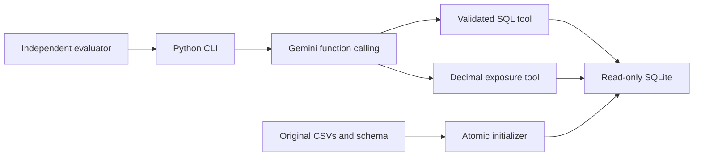

# PortiQ — PL Capital Portfolio Intelligence Agent

A CLI-first Gemini agent for the supplied PL Capital take-home dataset. Gemini selects
typed analytical tools and generates SQLite queries; Python performs deterministic equity
sector calculations. Every answer includes inspectable tool evidence. This is static
demonstration data, not a live market feed or investment recommendation.

```powershell
uv sync --frozen --extra dev
Copy-Item .env.example .env
# Set GEMINI_API_KEY in .env locally. Never commit the key.
uv run portfolio-agent init-db
uv run portfolio-agent ask "How many portfolios do we have in total?" --show-sql
uv run portfolio-agent chat
```

Python 3.11+ and [uv](https://docs.astral.sh/uv/getting-started/installation/) are required
for the locked workflow. On macOS/Linux use `cp .env.example .env` instead of `Copy-Item`.
Run commands from the repository root; `--source` and `--db` support other locations.

The original [assignment README](docs/assignment/README.md), schema, nine CSVs,
ground-truth file and suggested `requirements.txt` are preserved. Runtime dependencies
are defined in `pyproject.toml` and exactly resolved in `uv.lock`; the suggested original
requirements include optional UI/scientific packages that this CLI does not need.

## What works

- Atomic schema-aware CSV ingestion, reproducible rebuilds, FK and data validation.
- Genuine Gemini function calling with manual typed dispatch and multiple analytical tools.
- Text-to-SQL with parsed validation, SQLite authorization, read-only connections and limits.
- Stock-only sector exposure from `current_weight`, Decimal arithmetic and explicit normalization.
- Bounded SQL repair, duplicate-failure detection, model errors and ambiguous-name clarification.
- Independent supplied and extended evaluation, fresh calls, JSON/Markdown reports and traces.
- Key-free automated tests, Ruff, strict mypy and GitHub Actions.

There is no benchmark lookup in runtime code. The CLI works independently of a frontend.
Optional dashboard and REST API work is deferred in favor of the assignment's core requirements.

## Configuration and installation

The tested model is `gemini-3.1-flash-lite`. Set `GEMINI_MODEL` to another model available
to your account if needed. Model availability and quota vary; a successful model list
does not guarantee successful generation. `doctor --live` makes a real generation call.

| Setting | Default | Meaning |
|---|---|---|
| `GEMINI_API_KEY` | required for AI commands | Local secret; deterministic commands need no key |
| `GEMINI_MODEL` | `gemini-3.1-flash-lite` | Configured Gemini model ID |
| `PORTIQ_DB` | `portfolio_database.db` | Read-only analytical database path |
| `PORTIQ_SOURCE` | `.` | Directory containing supplied schema, CSVs and evaluation files |
| `PORTIQ_REQUEST_INTERVAL` | `13` | Minimum seconds between requests within one process |

The conservative pacing default accommodates the observed five-requests/minute preview
quota. It is not a quota guarantee. The release evaluation uses 6.5 seconds on Flash-Lite;
set your own interval according to your account. Multiple CLI processes do not share a limiter.
No persistent answer cache is enabled. The CLI's `--model`, `--db` and `--source` options
come **before** the subcommand.

A regular pip installation is also supported, though `uv.lock` is the canonical tested resolution:

```powershell
python -m venv .venv
.venv\Scripts\python -m pip install -e ".[dev]"
.venv\Scripts\portfolio-agent --help
```

On macOS/Linux the corresponding executables are `.venv/bin/python` and
`.venv/bin/portfolio-agent`. A clone with source data is required; the installed wheel
does not bundle the assessment dataset. No deprecated `google.generativeai` API is used.

## CLI examples

```powershell
uv run portfolio-agent --help
uv run portfolio-agent doctor
uv run portfolio-agent doctor --live
uv run portfolio-agent init-db --rebuild
uv run portfolio-agent exposure "Balanced Portfolio"
uv run portfolio-agent sql "SELECT COUNT(*) FROM portfolios"
uv run portfolio-agent ask "What are the sector exposures for Tech Innovation Fund?" --json
uv run portfolio-agent ask "Show the top 5 holdings by cost basis in Growth Equity Fund" --show-sql
uv run portfolio-agent ask "Compare Balanced Portfolio sector exposure and the current AAPL price" --trace
uv run portfolio-agent chat --show-sql
```

`chat` supports `help`, `exit`, EOF and Ctrl+C. Each question starts a fresh context; name
the portfolio in every question. Normal output shows a generated summary followed by
authoritative tables or exposure calculations. JSON includes request ID, status, model,
provider model version, tool arguments, SQL, attempts, errors, durations and token totals.
`--verbose` enables operational logging without provider payloads or hidden reasoning.
Failed/partial asks exit 1; valid answers, clarification and unsupported responses exit 0.

For Balanced Portfolio, stock weight is 0.36: Technology 61.11%, Financials 22.22%,
Healthcare 16.67%. Bonds are excluded from both numerator and denominator. The reported
equity weight makes the calculation basis explicit. Bond-only portfolios receive an
undefined-exposure error. See [data assumptions](docs/DATA_ASSUMPTIONS.md) for the 0.98
index weight total, AUM/market-value differences and supplied question conventions.

## Evaluation

These commands use real Gemini requests and consume your account's quota:

```powershell
uv run portfolio-agent evaluate --output reports/local/supplied.json
uv run portfolio-agent evaluate --trials 2 --output reports/local/repeated.json
uv run portfolio-agent evaluate --suite extended --output reports/local/extended.json
uv run portfolio-agent evaluate --suite extended --split heldout --output reports/local/heldout.json
uv run python scripts/release_evaluation.py
```

The release script runs two supplied trials followed by all 50 extended questions with
one backend and 6.5-second pacing. The evaluator executes reference SQL independently,
re-executes generated SQL, and checks full results, projection width, duplicate rows,
ordering and numeric tolerances. Exposure references read the original CSVs independently
of the production calculator. Extra, missing or truncated results fail. Tool routing is
scored separately. Alias spelling is allowed; projection position and values must agree.

The extended suite was authored here and frozen before its first live run. Its 17
development, 17 validation and 16 heldout cases are not an externally blind benchmark.
See [evaluation methodology](docs/EVALUATION.md) and committed `reports/` artifacts for
actual scores and failures. Targets such as 10/10 or 45/50 are not claims of achievement.

## Verification

```powershell
uv run ruff check .
uv run ruff format --check .
uv run mypy
uv run pytest --cov=portiq --cov-report=term-missing
uv run python scripts/benchmark.py
```

Ordinary tests use injected deterministic Gemini responses and no API key. The separate
opt-in live test requires `PORTIQ_LIVE=1` and initialized source data/database:

```powershell
$env:PORTIQ_LIVE = "1"
uv run pytest -m live -q
Remove-Item Env:PORTIQ_LIVE
```

Mock tests verify orchestration, validation and failures; only live reports establish
measured AI accuracy. CI runs formatting, linting, type checks, tests, coverage, database
initialization, CLI help, doctor and exposure smoke checks without secrets.

## Architecture and review notes



The SQL boundary combines SQLGlot parsing, an explicit SQLite authorizer, allowed
functions, `mode=ro`, `query_only=ON`, result limits and a VM deadline. It is a local
analyst tool rather than an isolated multi-tenant execution service. The model's prose
can still misstate valid results; the structured evidence is authoritative.

Further documentation:

- [Requirement traceability](docs/REQUIREMENTS.md) and [data audit](docs/DATA_ASSUMPTIONS.md)
- [Architecture](docs/ARCHITECTURE.md) and [decisions](docs/DECISIONS.md)
- [Security](docs/SECURITY.md) and [performance](docs/PERFORMANCE.md)
- [Evaluation](docs/EVALUATION.md), [limitations](docs/KNOWN_LIMITATIONS.md) and [interview notes](docs/INTERVIEW.md)
- [Acceptance record](docs/ACCEPTANCE.md)
