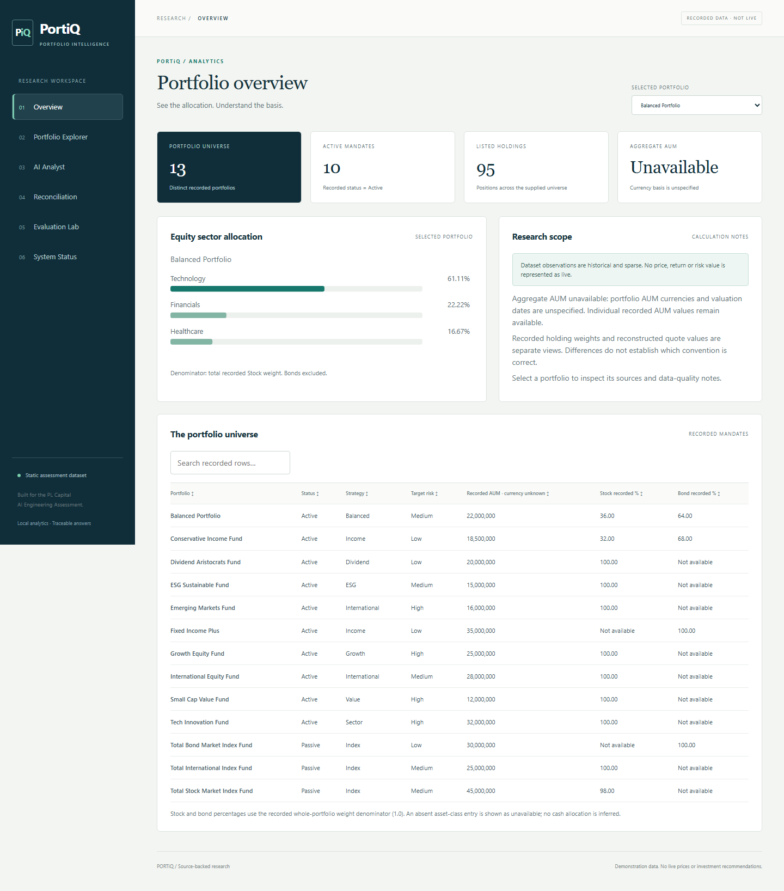
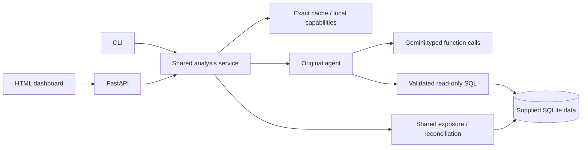

# PortiQ — AI-Powered Portfolio Intelligence

Built for the PL Capital AI Engineering Take-Home Assessment.

The four required components remain the core of this project:

1. **Text-to-SQL:** Gemini generates SQLite queries; parsed validation and a read-only authorizer enforce the boundary.
2. **Equity-only sector exposure:** Python uses Decimal and normalizes stock `current_weight`; bonds are excluded.
3. **CLI agent:** genuine Gemini function calling selects and executes typed tools.
4. **Independent evaluator:** reference SQL runs independently; result, routing and limited narrative checks are reported separately.

The original [assessment instructions](docs/assignment/README.md), nine CSVs, schema, suggested requirements and frozen benchmarks remain unchanged. This is an incremental upgrade of v0.1.1. The dataset is static demonstration data, not a live feed or investment recommendation.

## CLI quick start

Python 3.11+ and [uv](https://docs.astral.sh/uv/getting-started/installation/) are required. Run from the cloned repository root.

```powershell
uv sync --frozen
Copy-Item .env.example .env
# Set GEMINI_API_KEY in .env locally; never commit it.
uv run portfolio-agent init-db
uv run portfolio-agent exposure "Balanced Portfolio"
uv run portfolio-agent sql "SELECT COUNT(*) FROM portfolios"
uv run portfolio-agent ask "List the names of Passive portfolios, alphabetically." --show-sql
uv run portfolio-agent chat
```

On macOS/Linux use `cp .env.example .env`. A pip alternative is `python -m pip install -e .`; `uv.lock` is the canonical tested resolution. The CLI does not require FastAPI, Node or a browser. A clone with the supplied data is required; wheels do not bundle the assessment dataset. Global `--model`, `--db`, `--source` options precede the subcommand.

`ask` and `chat` use the original orchestration by default. `chat --context` enables bounded conversation history; independent questions remain the default. `ask --local` and `chat --local --cache --context` explicitly enable the small local capability registry and in-memory exact cache.

```powershell
uv run portfolio-agent snapshot "Balanced Portfolio"
uv run portfolio-agent reconcile "Balanced Portfolio"
uv run portfolio-agent ask "Count all portfolios" --local --json
uv run portfolio-agent chat --local --cache --context
uv run portfolio-agent doctor
uv run portfolio-agent doctor --live
```

For the supplied Balanced Portfolio, equity weight is 0.36: Technology 61.11%, Financials 22.22%, Healthcare 16.67%. These values are computed from holdings. A bond-only portfolio has undefined equity exposure.

## Live evaluation

These commands consume real Gemini quota. Evaluation bypasses local routing and answer caching.

```powershell
uv run portfolio-agent evaluate --output reports/local/supplied.json
uv run portfolio-agent evaluate --suite extended --output reports/local/extended.json
```

Evaluation uses the same frozen questions, a paced backend and independent oracles. [Evaluation details](docs/EVALUATION.md) distinguish complete runs, partial failures, mocked tests and deterministic checks. Fresh v0.2 results are **10/10 supplied, 50/50 extended and 8/8 platform**. Historical v0.1.1 results remain separately preserved. Current evidence is indexed in [v0.2.0 reports](reports/v0.2.0/README.md).

## Optional API and dashboard

The optional platform adds shared analytics, reconciliation, data-quality notices, a six-view dashboard, bounded context, exact caching and quota controls.

```powershell
uv sync --frozen --extra web
uv run portfolio-agent init-db
uv run portfolio-agent serve
```

Open **http://127.0.0.1:8000**. Overview, Explorer, Reconciliation, Evaluation Lab and System Status work without a Gemini key. AI Analyst labels local calculation, cached answers and genuine model analysis. Its default local/cache settings are visible; turn both off to demonstrate genuine Gemini analysis. Enter an optional demo access token through System Status; it remains in browser memory.



The UI uses original HTML/CSS/JavaScript, system fonts and local assets. There is no frontend build requirement. Charts show actual observations and missing-data notices; they do not imply live market coverage.

```powershell
Invoke-RestMethod http://127.0.0.1:8000/api/health
Invoke-RestMethod http://127.0.0.1:8000/api/portfolios/4/exposure
Invoke-RestMethod http://127.0.0.1:8000/api/portfolios/4/reconciliation
Invoke-RestMethod -Method Post -Uri http://127.0.0.1:8000/api/ask -ContentType application/json -Body '{"question":"Count all portfolios","local":true,"cache":false}'
```

The typed API schema is at `/openapi.json` (interactive documentation is disabled). `/api/conversation` accepts a returned opaque session ID; `/api/ask` is independent. Selected portfolios use numeric IDs from `/api/portfolios`. Set `PORTIQ_DEMO_TOKEN` before a network bind, and send `Authorization: Bearer <token>` from API clients. The Gemini key stays on the server.

## Docker

```powershell
docker build -t portiq:0.2 .
docker run --rm --name portiq-demo -p 127.0.0.1:8000:8000 portiq:0.2
```

The non-root container initializes its database reproducibly and serves the deterministic dashboard without credentials. Model requests return a clean 503 when no key is configured. For AI, pass a private environment file at runtime with both `GEMINI_API_KEY` and `PORTIQ_DEMO_TOKEN`; never bake secrets into the image. A volume mounted at `/app/runtime` can retain the database and quota ledger; ensure UID 10001 can write it. No public deployment is claimed. See [submission instructions](docs/SUBMISSION.md).

## Configuration

| Variable | Default | Scope |
|---|---|---|
| `GEMINI_API_KEY` | empty | Required only for genuine AI requests |
| `GEMINI_MODEL` | `gemini-3.1-flash-lite` | Account availability varies; use `doctor --live` |
| `PORTIQ_DB`, `PORTIQ_SOURCE` | `portfolio_database.db`, `.` | Dataset location |
| `PORTIQ_REQUEST_INTERVAL` | 13 seconds | Minimum spacing between SDK starts in one backend |
| `PORTIQ_DAILY_REQUESTS` | 200 | Actual SDK attempts per UTC day in the configured ledger |
| `PORTIQ_QUOTA_DB` | unset | Optional shared SQLite file; otherwise instance memory |
| `PORTIQ_FALLBACK_MODELS` | empty | At most two explicit sequential alternatives |
| `PORTIQ_CIRCUIT_FAILURES`, `PORTIQ_CIRCUIT_SECONDS` | 3, 30 | Transport/transient failure circuit and client refresh |
| `PORTIQ_DEMO_TOKEN` | unset | Optional bearer token; required for CLI network binding |
| `PORTIQ_CORS_ORIGINS` | empty | Explicit permitted origins, comma-separated |
| `PORTIQ_ALLOWED_HOSTS` | local hosts | Explicit additional hosts, comma-separated |
| `PORTIQ_RATE_LIMIT` | 60/minute | Socket-client API rate limit; one server worker supported |

The counter is not Google's quota meter. Failed attempts count conservatively even when delivery is unknown. Shared-file coordination applies only to processes using the same file and settings. Pacing and the circuit remain backend-local. Daily/authentication failures stop automatic retries; restart after fixing configuration. Hedging is deferred to avoid spending parallel quota.

## Verify and review

```powershell
uv sync --frozen --extra dev
uv run ruff check src tests scripts
uv run ruff format --check src tests scripts
uv run mypy src
uv run pytest --cov=portiq
npm ci
npx playwright install chromium
npm run test:web
```

Ordinary CI is key-free: the existing four Python/OS jobs plus browser and real container checks. Opt-in live tests are separate. The current local suite has 204 passes and two live skips; exact coverage and final CI are recorded in the versioned verification report.



Start with [architecture](docs/ARCHITECTURE.md), [experiments](docs/EXPERIMENTS.md), [security](docs/SECURITY.md), [known limitations](docs/KNOWN_LIMITATIONS.md) and the [acceptance audit](docs/ACCEPTANCE.md). Quote-value reconstruction is illustrative: prices lack a common valuation date, AUM currencies are unspecified, and bond valuation conventions are incomplete. Recorded weights, reconstructed weights and equity-only exposure are explicitly different bases.
