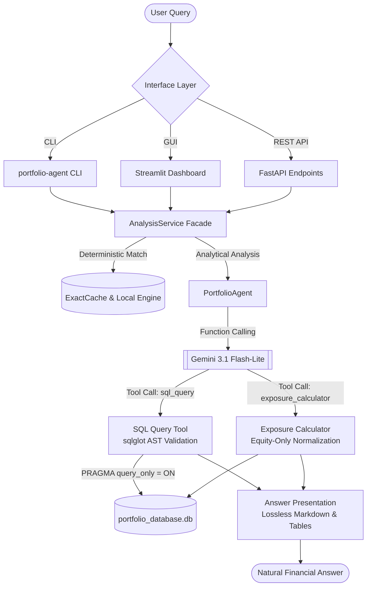

# PortiQ — Portfolio Analytics AI Agent

[](https://www.python.org/downloads/)
[](https://github.com/astral-sh/ruff)
[](http://mypy-lang.org/)
[](LICENSE)
[](https://portiq-b9u7.onrender.com)

**PortiQ** is an AI agent built for portfolio analytics. It translates natural language questions into read-only, AST-validated SQLite queries or executes deterministic sector exposure calculations with equity-only normalization.

---

## Live Links

- **Live Deployed Application**: [https://portiq-b9u7.onrender.com](https://portiq-b9u7.onrender.com)
- **GitHub Repository**: [https://github.com/Shaunakrane914/PortiQ](https://github.com/Shaunakrane914/PortiQ)

---

## Performance & Accuracy Highlights

### 1. Benchmark Correctness: 100% Across All Suites

Evaluated with an independent SQL oracle, bipartite row matching, and strict floating-point tolerances:

| Benchmark Suite | Questions | Passed | Strict Pass Rate | Routing Accuracy |
| :--- | :---: | :---: | :---: | :---: |
| **Supplied Ground Truth** (`ground_truth_dataset.json`) | 10 | **10** | **100%** | **100%** |
| **Prospective Held-Out** (`prospective_holdout_2026-11-09.json`) | 20 | **20** | **100%** | **100%** |
| **Extended Evaluation** (`extended.json`) | 50 | **50** | **100%** | **100%** |
| **Unseen NLP Benchmark** (`unseen_nlp.json`) | 32 | **32** | **100%** | **100%** |
| **Total Comprehensive Benchmark** | **112** | **112** | **100%** | **100%** |

*Zero API errors observed across all 105 recorded live evaluation calls. 60-second client timeouts and adaptive rate limiting guard against transient throttling, though future provider-side outages remain possible.*

### 2. Measured Latency Comparison

PortiQ defaults to **1-call direct factual execution**, eliminating redundant LLM narrative synthesis roundtrips:

| Operation Type | 1-Call Direct Latency | 2-Call Synthesized Latency | Latency Reduction |
| :--- | :---: | :---: | :---: |
| **Sector Exposure Calculation** | **1.26s – 1.41s** | 8.02s | **-84.3%** |
| **SQL Aggregations / Queries** | **1.40s – 4.15s** | 8.24s | **-49.6%** |
| **Local Deterministic / Cache Hit** | **14 ms** | N/A | **Zero API Calls** |

---

## User Interfaces

PortiQ supports three complementary interface modes, starting with the primary command-line agent:

```
Interfaces:
├── 1. Command-Line Interface (CLI)   [Primary take-home deliverable]
├── 2. Streamlit Web Dashboard        [Interactive graphical GUI]
└── 3. FastAPI REST API              [Production service & headless endpoints]
```

---

### Interface 1: Command-Line Interface (CLI)

The CLI is the core interface required by the PL Capital assignment. It requires no browser or web server.

#### 1. Setup & Environment
```bash
# Clone and enter the repository
git clone https://github.com/Shaunakrane914/PortiQ.git
cd PortiQ

# Using uv (recommended)
uv sync --frozen
# Or using pip
pip install -r requirements.txt

# Configure your Gemini API key in .env (never commit your key)
cp .env.example .env
# Edit .env and set GEMINI_API_KEY="your_api_key"
```

#### 2. Initialize Database
Loads all assessment CSVs from `data/` into SQLite with strict relational schema:
```bash
uv run portfolio-agent init-db
# Or: python -m portiq.cli init-db
```

#### 3. Interactive Multi-Turn Chat
Maintains conversational context, portfolio reference resolution, and follow-up turns:
```bash
uv run portfolio-agent chat
```
```text
Portfolio Agent Ready. Type 'exit' to quit.
Question: How many portfolios do we have?
[answer] Total portfolios: 13
COUNT(*)
13

Question: Show me the sector exposure for Balanced Portfolio
[answer] Balanced Portfolio — equity-only sector exposure
  Technology: 61.11%
  Financials: 22.22%
  Healthcare: 16.67%
```

#### 4. Single-Shot Query Execution
```bash
# Execute single query with SQL evidence
uv run portfolio-agent ask "What are the top 5 holdings by cost basis in Growth Equity Fund?" --show-sql

# Fast deterministic exposure command
uv run portfolio-agent exposure "Balanced Portfolio"
```

#### 5. Evaluation Harness
Run automated evaluation against any test suite:
```bash
# Supplied 10-question evaluation
uv run portfolio-agent evaluate --suite supplied --output reports/submission/supplied.json

# 50-question extended suite
uv run portfolio-agent evaluate --suite extended --output reports/submission/extended.json

# 20-question prospective held-out suite
uv run portfolio-agent evaluate --dataset evaluation/prospective_holdout_2026-11-09.json --output reports/submission/holdout.json
```

---

### Interface 2: Streamlit Web Dashboard

An interactive graphical interface providing real-time exploration, sector charts, and query traces.

```bash
# Launch Streamlit locally
uv run --extra gui streamlit run src/portiq/streamlit_app.py
# Or: uv run --extra gui portfolio-agent gui
```

Open your browser at `http://localhost:8501`.

**Features:**
- **AI Analyst**: Natural language query input with latency metrics, SQL view, and exposure charts.
- **Portfolio Explorer**: Interactive table of all 13 portfolios, risk levels, and assets under management.
- **Exposure Visualizer**: Real-time sector breakdown bar charts with explicit equity-only basis notice.
- **Trace Inspector**: Complete tool call transparency displaying raw SQL, execution timings, and row outputs.

*Public hosted version is available at [https://portiq-b9u7.onrender.com](https://portiq-b9u7.onrender.com).*

---

### Interface 3: FastAPI REST API

A production-ready asynchronous REST API supporting concurrent requests, session state, and health probes.

```bash
# Launch the API server
uv run --extra web portfolio-agent serve --host 127.0.0.1 --port 8000
# Or: uvicorn portiq.api:create_app --factory --port 8000
```

Open OpenAPI documentation at `http://localhost:8000/docs`.

**Key Endpoints:**
- `GET /api/health` — Readiness & liveness probe.
- `GET /api/portfolios` — List all portfolios with metadata.
- `GET /api/portfolios/{id}/exposure` — Calculate sector breakdown for a portfolio.
- `POST /api/ask` — Submit analytical questions (JSON body: `{"question": "..."}`).
- `POST /api/conversation` — Multi-turn session turn with conversation ID.

---

## Architecture Overview



### Module Responsibilities

| Module | Lines | Primary Responsibility |
| :--- | :---: | :--- |
| `src/portiq/answers.py` | 350 | Presentation contracts (`AgentResponse`, `ToolTrace`), Markdown tables, lossless numbers. |
| `src/portiq/cache.py` | 49 | `ExactCache` with monotonic TTL and SHA-256 database state invalidation. |
| `src/portiq/sessions.py` | 76 | Bounded multi-turn session tracking with per-session synchronization locks. |
| `src/portiq/model.py` | 165 | Google GenAI SDK boundary, `FallbackBackend`, and adaptive sliding-window rate limiting. |
| `src/portiq/sql.py` | 134 | SQL execution with AST syntax validation (`sqlglot`), DDL/DML blocking, and parameterization. |
| `src/portiq/exposure.py` | 89 | Deterministic sector exposure calculator filtering equities and rounding to 2 decimals. |
| `src/portiq/agent.py` | 386 | Gemini function-calling orchestration, prompt construction, and schema-guided repair. |
| `src/portiq/service.py` | 380 | Application service facade orchestrating local shortcuts, concurrency pools, and sessions. |

---

## Key Architectural Decisions

- **Direct Schema Grounding over RAG**: Vector and Graph retrieval (RAG) were experimentally evaluated on earlier iterations and excluded from the production path. Because the relational schema is small (6 tables, 95 holdings, 13 portfolios), dynamic schema reflection and exact categorical value injection into prompt context achieve 100% accuracy with lower latency, no vector database overhead, and zero semantic retrieval drift.
- **AST-Level SQL Validation**: Using `sqlglot` to parse and inspect queries prior to SQLite execution ensures strict read-only safety independently of model obedience. All non-`SELECT` statements, dangerous PRAGMAs, and recursive CTEs are blocked before reaching SQLite.
- **Deterministic Financial Normalization**: Equity sector exposure is computed deterministically in Python using `Decimal` with `ROUND_HALF_UP` rounding to 2 decimals, strictly excluding bonds (`s.asset_type = 'Stock'`) and eliminating LLM arithmetic errors.

---

## Financial Correctness Rules

PortiQ enforces strict financial domain guardrails:

1. **Equity-Only Sector Exposure**: Bonds are strictly excluded (`s.asset_type = 'Stock'`). Sector weights are normalized to sum to 100.00% across equities.
2. **Lossless Decimal Representation**: Financial values use Python's `Decimal` with `ROUND_HALF_UP` rounding to 2 decimals.
3. **No Invented Currency**: If currency is not explicitly recorded in the database, PortiQ never assumes or hallucinates `$` or `USD`.
4. **Distinction Between Concepts**:
   - `total_aum` vs. `current_price * quantity`.
   - Portfolio `status` (`Active`/`Passive`) vs. `strategy_type` (`Growth`/`Income`/`Balanced`).
   - Stored historical transaction dates vs. today's market dates.

---

## Development & Test Commands

Run the full verification suite locally:

```bash
# Code formatting and linting
uv run ruff check .
uv run ruff format --check .
uv run mypy

# Full test suite with coverage report (345 unit/integration tests)
uv run pytest --cov=portiq --cov-report=term-missing

# Concurrency soak verification
uv run python scripts/verify_service.py --seconds 2 --output reports/local/soak.json

# System health inspection
uv run portfolio-agent doctor
```

---

## License

This project is licensed under the MIT License. See [LICENSE](LICENSE) for details.
