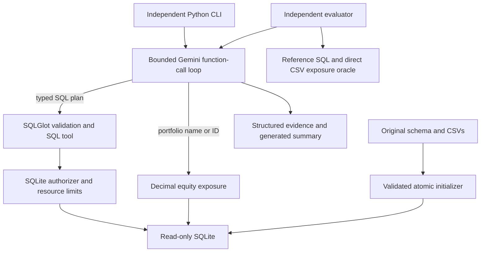

# Architecture

The maintained Google GenAI SDK handles network transport. Automatic SDK function
execution is disabled: this application validates and executes every tool call itself.
Gemini generates a SQL draft in its typed function arguments. Simple queries execute after
validation without an extra planning request. Drafts with at least five joins or two CTEs
use a focused SQL planner before execution; this structural heuristic was introduced after
an actual aggregate-scope failure. The same structured generator performs bounded correction.
This heuristic contains no question text, portfolio names, sectors or benchmark identifiers.
It is not a guarantee of semantic correctness. There is no keyword router or benchmark lookup.

The system context includes the actual portfolio ID/name catalogue read from SQLite, with
values explicitly labeled as data. This gives the model name grounding without injecting
benchmark answers or repeatedly asking broad discovery queries. Schema, catalogue and
conventions are built once per agent instance.

v0.1.1 additionally snapshots bounded distinct values for `portfolios.status` and
`portfolios.strategy_type`. These values come from SQLite, not a benchmark lookup or fixed
enum. At most 16 values of 80 characters each are included, with an explicit completeness
flag. Keeping this context limited to the reviewed portfolio-classification problem avoids
introducing unrelated sector/industry aliases into model planning. Both routing and the
focused SQL planner receive the same context.

Each request has a fresh conversation. Model response content, including provider thought
signatures, is retained only while that request runs. Function response IDs are preserved.
Trace output contains arguments, results and operational metadata, never hidden reasoning.

The loop permits six analytical calls, three total SQL attempts per SQL tool call, and a
bounded number of turns. Final responses must stand alone and require tool evidence for
answer status. Tool errors prevent a fully successful answer. Model errors do not become
fabricated fallback answers. Authoritative tables/calculations remain separate from the
model's generated narrative.

Database initialization alone writes data. It loads a sibling temporary SQLite file,
validates all records inside a transaction, closes it, and atomically replaces the target.
An unsuccessful rebuild leaves the previous file intact. Queries open `mode=ro` connections
with `query_only=ON`; no web server is needed by any CLI command.

The schema context is read once per agent instance from the live database. There is no
persistent cache, so no invalidation ambiguity or warm-answer leakage into evaluation.
