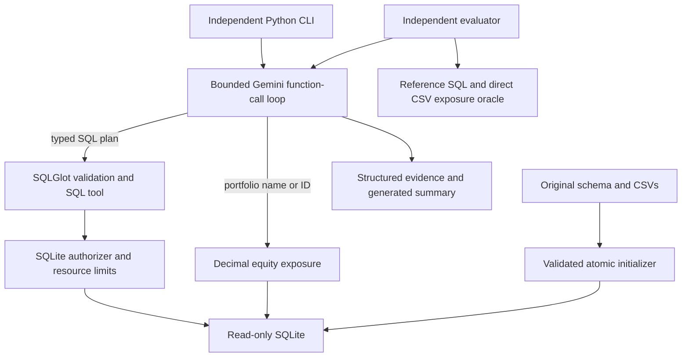

# Architecture

The maintained Google GenAI SDK handles network transport. Automatic SDK function
execution is disabled: this application validates and executes every tool call itself.
Gemini generates SQL in its typed function arguments, avoiding an extra planning request.
The standalone SQL-generation path is also used for bounded correction when initial SQL
fails. There is no keyword router or benchmark lookup in production.

Each request has a fresh conversation. Model response content, including provider thought
signatures, is retained only while that request runs. Function response IDs are preserved.
Trace output contains arguments, results and operational metadata, never hidden reasoning.

The loop permits six analytical calls, three total SQL attempts per SQL tool call, and a
bounded number of turns. Final responses must stand alone and require tool evidence for
answer status. Tool errors prevent a fully successful answer. Model errors do not become
fabricated fallback answers. Authoritative tables/calculations remain separate from the
model's generated narrative.

Database initialization alone writes data. It loads a sibling temporary SQLite file,
validates all records inside a transaction, closes it, and atomically replaces the target.
An unsuccessful rebuild leaves the previous file intact. Queries open `mode=ro` connections
with `query_only=ON`; no web server is needed by any CLI command.

The schema context is read once per agent instance from the live database. There is no
persistent cache, so no invalidation ambiguity or warm-answer leakage into evaluation.
