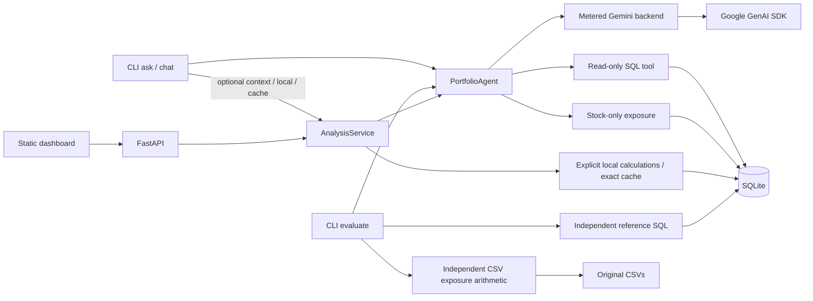

# Architecture

The original [assignment](assignment/README.md) requires SQL translation, equity sector exposure, CLI tool selection and a CLI evaluator. They remain the core. The optional HTTP/UI layer adapts the same calculations and agent.

## Components and ownership

| Component | Implementation | Responsibility |
|---|---|---|
| CLI | [cli.py](../src/portiq/cli.py) | `chat`, `ask`, supplied/extended `evaluate`, deterministic tools and optional server startup |
| Ingestion/context | [database.py](../src/portiq/database.py) | Validate all CSVs, atomically initialize SQLite, read schema/domains/catalogue |
| Gemini agent / SQL planning | [agent.py](../src/portiq/agent.py), [prompts.py](../src/portiq/prompts.py) | Typed tool selection, focused complex-query planning, bounded repairs, final rendering |
| SQL execution | [sql.py](../src/portiq/sql.py) | Parse, authorize, bound and execute read-only queries |
| Required exposure calculator | [exposure.py](../src/portiq/exposure.py) | Resolve one portfolio and normalize stock weights by stock sector |
| Independent evaluation | [evaluation.py](../src/portiq/evaluation.py), [faithfulness.py](../src/portiq/faithfulness.py) | Reference SQL / CSV arithmetic, evidence comparison, limited narrative contracts |
| Provider boundary | [model.py](../src/portiq/model.py), [quota.py](../src/portiq/quota.py) | SDK calls, actual usage, pacing, local budget, safe retry/circuit handling |
| Optional service | [service.py](../src/portiq/service.py) | Explicit local capabilities, exact cache, context and sequential fallback |
| Optional analytics | [analytics.py](../src/portiq/analytics.py) | Snapshots, quote-value reconciliation and data-quality notices |
| Optional platform | [api.py](../src/portiq/api.py), [web/](../src/portiq/web/) | Single-worker REST adapter and four-view static interface |

## CLI and agent request flow

`ask`, bare `chat` and `evaluate` construct the agent directly. Optional `--context`, `--local` or `--cache` CLI modes use `AnalysisService`. `sql` executes explicit SQL and `exposure` invokes the calculator directly, without Gemini.

The agent supplies the live schema, bounded portfolio classification domains, portfolio catalogue and financial conventions to Gemini. Schema formatting is compacted without changing its parsed SQL structure. Runtime planning code does not load frozen questions, expected SQL or narrative assertions.

Gemini returns typed `sql_query`, `exposure_calculator` or `respond` calls. SQL arguments include the generated query; structurally complex drafts receive focused planning. Invalid SQL can be regenerated within the configured attempt budget. Python validates all arguments and executes analytical tools before returning results to the model. Hybrid questions can use both analytical tools. Answers require successful tool evidence; failed tools remain visible through error/partial statuses.

Ordinary answers use model synthesis plus authoritative structured evidence. The scalar-only shortcut requires explicit supported output wording, exactly one analytical SQL call, no tool error, one column/row, no truncation and no guarded compound wording. It renders the value directly and labels `rendering` as `deterministic scalar rendering after Gemini SQL`. This removes a summary generation call; Gemini still interprets the question and generates SQL. It does not restore the removed experimental one-call planner.

## Data and calculation boundaries

SQLite is file-backed so separate CLI invocations and the optional API can share it. `init-db` loads the supplied schema/CSVs into a sibling temporary file, validates constraints and integrity, then atomically replaces the requested database when explicitly rebuilding. The brief's in-memory setup hint is not implemented as a separate mode; its sample also uses a database file.

Exposure normalizes only `Stock` `current_weight` and excludes bonds. Reconciliation compares recorded allocations with illustrative `quantity * current_price` allocations only when values are complete and one known currency permits a denominator. No FX, inferred cash, accrued interest or AUM rescaling is introduced. [Data conventions](DATA_ASSUMPTIONS.md) explain the supplied reference contracts.

The evaluator independently re-executes generated SQL and reference SQL. Exposure references use original CSVs rather than the production calculator/resolver. SQL safety and result correctness are separate checks; [evaluation scope](EVALUATION.md) describes the limited narrative assertions.

## Provider accounting and failure handling

SDK automatic function calling and automatic request retries are disabled. Application orchestration owns the tool loop and bounded retries. Every actual SDK invocation reserves a local daily attempt, including delivery-unknown failures. Per-call metrics separate provider/network service from deliberate pacing; question metrics also expose backoff and end-to-end time. Missing usage stays unknown.

The default minimum SDK-start interval is 13 seconds; the captured CLI run and Render blueprint use 6.5 seconds. No rolling-minute Gemini scheduler is implemented. Daily/authentication failures stop automatic retries; transient failures have bounded retry/backoff and a circuit that refreshes the client after cooldown. Optional explicitly configured fallback models run sequentially and share the ledger. File-backed daily accounting coordinates only processes sharing its file/settings; it is not Google's project quota meter.

## Optional service, cache and sessions

The local registry covers four anchored capabilities: portfolio count, unambiguous exposure, holdings and metadata. Other language goes to Gemini. Cache/local results are labeled and consume zero SDK calls; live evaluations bypass both. CLI flags opt in. The UI defaults both checkboxes off, while raw API request fields default to true when omitted; the UI sends its explicit selection.

The exact cache holds up to 64 successful, deep-copied responses for 300 seconds. Keys include exact trimmed question, database bytes/rebuild identity, runtime code, model/fallback configuration, strategy and session context. Errors are not cached. Sessions keep eight turns and bounded tool/reference summaries, with up to 100 sessions and a 30-minute TTL. Random session IDs are bearer capabilities, not authenticated user identities. Browser transcripts stay in page memory.

The API supports one worker and one analytical request at a time; a concurrent analysis is rejected as busy. Its existing socket-client HTTP rate limit is separate from Gemini pacing. General multi-user concurrent execution, distributed scheduling and per-user cost accounting are not implemented.

## Packaging and platform

The base package needs no web or Node dependencies. The `web` extra adds FastAPI/Uvicorn; Node/Playwright are development-only. Docker starts `python -m portiq.api`, initializes a missing database from bundled inputs and runs as UID/GID 10001. A writable runtime directory holds the database and daily ledger. Reports, evaluation fixtures, local databases and `.env` are excluded from the image.

The hosted Render instance is an optional anonymous demonstration configured through [render.yaml](../render.yaml), not a production multi-tenant readiness claim. [Submission](SUBMISSION.md#configuration) documents the different network-bind rules for CLI `serve` and the container entry point.

The frontend opens AI Analyst first, then offers Overview, Portfolio Explorer and Reconciliation. Internal evaluation/configuration/cache routes and public OpenAPI discovery are disabled. Navy, ivory and gold are the three base colors; fonts/assets are local. No benchmark reports or assessment documents are served by the static app.
